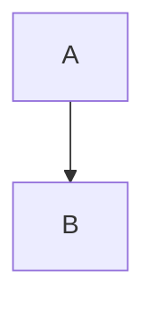
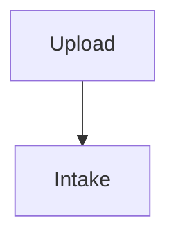

# mdpdf

Turns a Markdown file into a PDF with the finish a client-facing document needs:
a cover page, a table of contents carrying each entry's real page number, running
headers, every `##` section opening on a fresh page, tables that repeat their
header when they break across pages, and Mermaid diagrams rendered as vector art
on their own A4 portrait page, matching the rest of the document.

The Markdown stays the single source of truth — nothing is ever edited in the PDF.

Visual identity comes from a **theme**, and a theme can be derived automatically
from a `DESIGN.md` (see [Design engine](#design-engine)).

---

## Installation

### Dependencies

| What | For | Required |
|---|---|---|
| `python3` **3.11+** | the pipeline (uses `tomllib` from the stdlib) | yes |
| `pandoc` | Markdown → HTML with GitHub-style anchors | yes |
| `weasyprint` | HTML → PDF, pagination, page-number resolution | yes |
| `npx` | fetches `@mermaid-js/mermaid-cli` on demand | diagrams only |
| Chromium/Chrome/Edge | engine behind mermaid-cli | diagrams only |

```bash
# Debian / Ubuntu
sudo apt install python3 pandoc weasyprint

# Fedora
sudo dnf install python3 pandoc weasyprint

# Arch
sudo pacman -S python pandoc python-weasyprint

# macOS
brew install python@3.12 pandoc weasyprint

# Windows (winget / pip)
winget install Python.Python.3.12 JohnMacFarlane.Pandoc
pip install weasyprint
# Note: On Windows, WeasyPrint uses native GTK3 / GObject DLLs (e.g. from MSYS2, Scoop, or Graphviz)
# discovered on PATH. mdpdf uses the Python API directly and falls back to the weasyprint CLI if
# the module or native libraries fail to load.
```

Without `npx` or a browser everything else still works; only ` ```mermaid `
blocks stop becoming figures.

### Install

#### Linux / macOS

```bash
git clone <this repo> ~/OS      # or just copy the folder
cd ~/OS/mdpdf
./install.sh
```

The script checks dependencies, copies to `~/.local/share/mdpdf/` and writes the
executable to `~/.local/bin/mdpdf`. If `~/.local/bin` is not on your `PATH` it
says so and prints the line to add to your `~/.zshrc`.

```bash
./install.sh --link        # symlink install: editing the repo takes effect immediately
./install.sh --uninstall   # remove
```

#### Windows (PowerShell)

```powershell
git clone <this repo> mdpdf
cd mdpdf
powershell -ExecutionPolicy Bypass -File .\install.ps1
```

The Windows script checks dependencies, copies files to `%LOCALAPPDATA%\mdpdf` and creates command wrappers in `%LOCALAPPDATA%\Programs\mdpdf\bin` (`mdpdf.cmd` and `mdpdf.ps1`).

```powershell
powershell -ExecutionPolicy Bypass -File .\install.ps1 -Link        # symlink install
powershell -ExecutionPolicy Bypass -File .\install.ps1 -Uninstall   # remove
```

Re-running `install.sh` upgrades in place. It never touches `~/.cache/mdpdf/` or
the `mdpdf.toml` files in your projects.

### Verify

```bash
mdpdf themes
```

Should list `plain` and `cobalt`.

---

## Commands

```bash
mdpdf                          # build the only .md in the current folder
mdpdf document.md
mdpdf document.md -o "Client Report.pdf" # choose the output PDF name
mdpdf document.md -t plain     # override the theme for this run only
mdpdf --keep-html              # keep the intermediate HTML for debugging

mdpdf themes                   # list installed themes
mdpdf init -t cobalt -b "Acme" # scaffold this folder's mdpdf.toml
mdpdf design docs/DESIGN.md    # derive the palette from a design document
mdpdf design docs/DESIGN.md -n # dry run: show the result, write nothing
```

| Flag | Applies to | Meaning |
|---|---|---|
| `-o, --output` | build, design | output filename or path (PDF, or the TOML for `design`) |
| `-t, --theme` | build, init, design | theme to use |
| `-n, --dry-run` | design | print the result without writing |
| `--keep-html` | build | preserve the intermediate HTML |
| `--force` | init | overwrite an existing `mdpdf.toml` |

---

## Typical uses

### 1. One-off PDF, no setup

Drop a `.md` in a folder and run `mdpdf`. You get the neutral `plain` theme with
system fonts, a cover, a paginated table of contents and running headers. No
config file needed.

```bash
cd ~/proposals/acme && mdpdf
```

### 2. A recurring client, with identity

Give the folder an `mdpdf.toml` once. Every document in it inherits the brand.

```bash
cd ~/clients/acme
mdpdf init -t cobalt -b "Acme"
mdpdf "Requirements Engineering.md"
```

### 3. You already have a design system

Point the engine at the design document and let it work out the print palette.

```bash
cd ~/clients/acme
mdpdf design docs/DESIGN.md -n     # inspect the reasoning first
mdpdf design docs/DESIGN.md        # accept and write mdpdf.toml
mdpdf proposal.md
```

### 4. Same document, two audiences

Keep one Markdown file and switch identity at print time.

```bash
mdpdf report.md -t cobalt -o report-client.pdf
mdpdf report.md -t plain      -o report-internal.pdf
```

### 5. Iterating on a theme

Install by symlink, then edit `themes/<name>/theme.toml` in the repo and rebuild.
No reinstall step in the loop.

```bash
./install.sh --link
$EDITOR ~/OS/mdpdf/themes/acme/theme.toml
mdpdf document.md
```

---

## Writing the document

```markdown
# Product Name — Document Type

**Client:** ...
**Product:** ...
**Document:** ...
**Version:** 1.0
**Date:** 2026-08-07
**Author(s):** ...
**Classification:** Confidential

---

## Table of Contents

1. [Introduction](#1-introduction)
   - 1.1 [Purpose](#11-purpose)

---

## 1. Introduction
```

- The `#` heading and the `**Field:** value` lines become the **cover**. The
  title is split on the `—`: what comes before is the large name, what comes
  after is the subtitle.
- `Product`, `Document` and `Classification` have dedicated roles on the cover;
  every other field becomes a cell in the metadata grid at its foot.
- The identification block ends at the first `---` **or** the first `##`.
- The title and the field values take inline `` `code` `` and `*emphasis*`, so a
  document named after an API can wear its own name: `` # `volatile` and
  `Interlocked` `` sets the code in the mono face on the cover, and the running
  header and the PDF metadata get the plain-text reading of it.
- The list right below `## Table of Contents` becomes the table of contents, with
  dot leaders and page numbers. Its links must point at GitHub-style anchors
  (`#1-introduction`).

To make the English cover fields fill those dedicated roles, use the settings
shown under [Language labels](#language-labels). The labels are configurable for
other languages as well.

### Diagrams and the page they get

Every ` ```mermaid ` block is rendered to vector SVG and captioned as
`Figura N — <the nearest heading>`. By default it gets a page of its own, fitted
inside the usable sheet. What sits directly above the block comes along: the
run of headings, plus the paragraphs immediately before it while their combined
text stays under
`diagram_lead_chars` (480 characters, about five lines). So a section that opens
with a heading and a couple of lines and then shows its diagram is printed as
one page, instead of leaving the heading stranded at the foot of the previous
one. Longer prose stays where it is and the diagram takes the whole sheet —
raise or lower `diagram_lead_chars` in `mdpdf.toml` to move that line.

Documents with many wide, shallow diagrams can opt into adaptive pagination:

```toml
diagram_layout = "auto"
diagram_inline_min_ratio = 1.5
```

`auto` reads the rendered SVG's `viewBox`: diagrams at least 1.5 times wider
than tall stay at full text width but flow with the surrounding prose; taller
diagrams keep the dedicated sheet. The complete heading/lead/figure/caption
group remains indivisible, and a `##` inside an inline group still opens a fresh
page. `page` preserves the original all-dedicated behavior and remains the
default; `inline` puts every diagram in the flow.

Override an individual diagram without changing the document setting:

````markdown

````

The accepted overrides are `auto`, `page` and `inline`.

### A trap worth knowing about

If you export the same `.md` through another path — a VS Code extension, the
browser's "print to PDF" — any content wider than the page makes Chrome **scale
the entire document down** to fit. A single long URL inside `code` in a table is
enough, and the result is a PDF set in tiny type from cover to back. `mdpdf`
does not suffer from this because WeasyPrint paginates rather than scales, but
if you keep both paths alive they will fight over the same output file. Pick one.

### Blocks beyond plain Markdown

Everything below stays valid Markdown; [`examples/showcase.md`](examples/showcase.md)
uses every one of them — build it to see the result.

**Numbered section openers.** A `##` whose title starts with a number
(`## 3. Results`) prints the number as a small mono eyebrow (`03`) before the
title, under a heavy rule. The running header and the PDF outline keep the full
`3. Results`.

**Callouts** use GitHub's alert syntax, so the file still renders on GitHub.
The label follows `alert_labels`; text after the marker replaces it:

```markdown
> [!NOTE]
> Plain note.

> [!WARNING] If it goes wrong
> Divergence blocks the dependent rules until review.
```

Kinds: `NOTE`, `TIP`, `IMPORTANT`, `WARNING`, `CAUTION`.

**Containers** are pandoc fenced divs. Each `###` inside starts a card; an
`#####` right above a `###` is that card's eyebrow:

```markdown
::: cards
##### 1 · catalogue
### What to check
Text, lists, code…

### How to check
…
:::
```

| container | result |
|---|---|
| `::: cards` | grid with a coloured top rule; 2 or 4 cards → two columns, 3 → three |
| `::: compare` | two side-by-side panels |
| `::: stats` | a list of `- **3** label` items becomes a strip of figures |
| `::: steps` | one card per step, each a link target for the diagram and with a link back to it |

Inside cards and steps, a list whose every item starts with a bold label
(`- **In:** …`) prints as label / value rows. In steps, `##### Category | Badge`
puts the badge on the right of the eyebrow. Steps carry no previous/next links:
neighbouring steps are already on the same or the next page, so such links only
jump to what the reader already sees.

**Clickable diagrams.** Mermaid's own `click` directive turns a node into a
real PDF link — point it at a heading, typically a step:



WeasyPrint keeps no links inside an SVG image, so mdpdf asks the headless
browser where each linked node is drawn (cached next to the SVG), lays the
document out once to find where the image landed, and lays invisible links
over the nodes. This needs the `weasyprint` module importable by the Python
that runs mdpdf; without it the diagram prints normally, unlinked, with a
warning. It costs one extra layout pass, only for documents that use `click`.

**Tables.** Columns whose filled cells are all numbers (`13.537,30`,
`R$ 2.559,94`, `73,93%`, `171×`) align right with tabular figures — a cell
holding only a dash (`—`) counts as a missing value — and long content
wraps inside the margin. Code in a header cell follows the header's ink, so it
stays legible on the accent fill.

**Tags and code captions — applied automatically.** A paragraph made only of
two or more code spans (`` `Docling` `Camelot` ``) prints as a row of tags, and
a paragraph entirely in italics right after a code block becomes its caption.
Neither needs new syntax, so an existing document with such paragraphs changes
look: add a word outside the code spans or the italics to keep the old one.

> [!CAUTION]
> With fenced divs enabled, a line made only of `:::` opens or closes a
> container. Escape it (`\:::`) if you need it literally.

---

## Per-folder configuration — `mdpdf.toml`

Optional, sits next to the `.md`.

```toml
theme = "cobalt"           # installed theme name, or a path to a theme folder

name = ""                  # output PDF filename; empty = same name as the .md
logo = "logo.png"          # image at the top of the cover; empty = none

brand  = "Acme"            # printed above the title on the cover
footer = "Confidential · Acme"  # page footer; omitted when empty
lang = "pt-BR"
keywords = ["SRS", "requirements"]

diagram_lead_chars = 480   # how much text may share a page with a diagram
diagram_layout = "page"    # page, auto or inline
diagram_inline_min_ratio = 1.5 # in auto, wide diagrams flow with the prose

[colors]                   # override any theme token
accent   = "#7a1fa2"
accent-2 = "#e0b341"
```

Precedence: built-in defaults → the theme's `theme.toml` → the folder's
`mdpdf.toml` → command-line flags.

### Naming the output — `name`

By default the PDF takes the `.md`'s own name. Set `name` when the file has to be
delivered under a name the source file cannot carry — a submission convention, a
client's numbering scheme:

```toml
name = "Saint Thomas Aquinas - Summa Theologica"
```

```console
$ mdpdf lecture-notes.md
✓ Saint Thomas Aquinas - Summa Theologica.pdf
```

- `.pdf` is appended when missing, and never duplicated if you write it yourself.
- `-o` still wins, so a one-off run can override the convention.
- It is a *filename*, not a path: `/`, `\` and control characters become `-`, so
  the PDF always lands next to the document. Spaces, parentheses and accents are
  kept as typed — that is the point of the option.
- Empty or absent behaves exactly like before the option existed.

### Putting a logo on the cover — `logo`

Point `logo` at an image file and it is printed at the top of the cover, in
place of the coloured rule:

```toml
logo = "logo.png"
```

The path is resolved **next to the document first, then inside the theme
folder** — and that is what makes a logo stick. Drop the file into
`~/.local/share/mdpdf/themes/<theme>/` and declare it in that theme's
`theme.toml`, and every future document built with the theme comes out with the
logo already on it, with nothing to configure again. Declare it in `mdpdf.toml`
instead and it stays scoped to that one folder.

```bash
cp acme-logo.png ~/.local/share/mdpdf/themes/cobalt/
echo 'logo = "acme-logo.png"' >> ~/.local/share/mdpdf/themes/cobalt/theme.toml
```

- PNG and SVG both work; the image is scaled to 15mm tall and never wider than
  70mm, keeping its aspect ratio.
- On a full-bleed cover the background is the accent colour, so a transparent
  PNG with light artwork reads best — a logo on a white rectangle will show that
  rectangle.
- A missing file is a hard error naming both places that were searched, rather
  than a cover that silently comes out bare.

---

## Design engine

```bash
mdpdf design docs/DESIGN.md            # update ./mdpdf.toml
mdpdf design docs/DESIGN.md -n         # dry run
mdpdf design docs/DESIGN.md -t cobalt
mdpdf --design docs/DESIGN.md          # same thing
```

Point it at a design document and it writes the `mdpdf.toml` for you.

The hard part is not reading hex values. A `DESIGN.md` almost always describes a
**screen** — dark background, a dozen surface steps, hover states, semantic
colors. A PDF is the opposite: dark ink on white paper. Copying the palette
would produce a black document. So the engine **classifies** instead:

1. **Scans** every `#rrggbb` in the file, keeping the row's label (or the first
   table cell) and the surrounding `##`/`###` section.
2. **Scores** each color for each print role by keyword, in Portuguese and
   English. A hit in the label counts more than a hit in the section.
3. **Penalises** what is screen circumstance rather than identity. A state word
   (`hover`, `pressed`, `wash`) costs `-4`, because a "Cyan Pressed" is the brand
   color one darkening step down, and electing it as the second color yields a
   single-hue palette. A structural word (`surface`, `border`, `semantic`) costs
   only `-2`, because in a dark UI the document's ink usually lives precisely in
   the *Surface* section — vetoing it outright would make the engine pick the
   brand color as body-text ink.
4. **Filters by luminance**: ink has to be dark, the cover's light tone has to be
   light, a brand color has to be saturated.
5. **Rebuilds** the supporting tones from the ink/paper pair instead of fishing
   greys out of a screen palette: `ink-soft`, `ink-muted`, `paper-alt`,
   `hairline`, `hairline-soft`, `accent-deep`, `cover-ink-soft`.
6. **Fixes contrast**: `accent-2-ink` is darkened until it clears 4.5:1 against
   paper, because a screen cyan is unreadable in print.
7. **Extracts typography**: stacks declared as `Stack:` or `font-family:`,
   sorted into `sans` and `mono`.

Every choice comes with its reasoning:

```
  ink            #1e2229  ← label "Canvas" in "Surface"
  accent         #0b3fd4  ← label "Cobalt" in "Brand & Accent"
  accent-2       #5aa2f0  ← label "Sky" in "Brand & Accent"
  cover-ink      #f6f8ff  ← label "Text on Cobalt" in "Text"
  paper          #ffffff  ← fixed: printing on white paper
  accent-2-ink darkened to 4.8:1 against paper (min. 4.5)
```

It is an explained guess, not an oracle. Run with `-n` first, read the reasoning,
and hand-correct anything you disagree with under `[colors]`. The previous
`mdpdf.toml` is kept as `mdpdf.toml.bak`.

**Fonts:** the engine can only write the *stack* (`sans`/`mono`). To embed the
font file itself it must be declared under `[[fonts]]` in a theme — the command
warns when the family it found is not packaged in the theme you selected.

---

## Themes

A theme is a folder under `~/.local/share/mdpdf/themes/<name>/`:

```
theme.toml     description, brand, color tokens, fonts, Mermaid overrides
style.css      optional — identity tweaks, loaded after base.css
fonts/         optional — packaged .ttf files
logo.png       optional — any image named by `logo` in theme.toml
```

`base.css` carries all the print layout and should not need per-theme changes.
Colors and families arrive as tokens:

```
--ink --ink-soft --ink-muted
--accent --accent-deep --accent-2 --accent-2-ink
--paper --paper-alt --hairline --hairline-soft
--cover-ink --cover-ink-soft
--sans --mono
```

The Mermaid theme is derived from those same tokens, so diagrams and prose can
never drift into different palettes. Override it under `[mermaid]` in
`theme.toml`.

Packaged fonts (path relative to the theme):

```toml
[[fonts]]
family = "Space Grotesk"
weight = 400
file = "fonts/SpaceGrotesk-400.ttf"
```

**New theme:** copy `themes/cobalt/`, change `[colors]`, add `[[fonts]]` if you
have font files, drop in a `logo`. Or run `mdpdf design` and paste the resulting
`[colors]`.

**Private themes:** a theme carrying a client's or an institution's marks does
not belong in a public repository. Keep the folder in the working tree, so
`install.sh` goes on shipping it to `~/.local/share/mdpdf`, and exclude its path
in `.git/info/exclude` — local to your clone, so the theme is never published
and its name never appears in the history.

### Bundled themes

| Theme | Description |
|---|---|
| `plain` | Neutral — grey and slate blue, system fonts, no files |
| `cobalt` | Cobalt and sky blue on white paper, full-bleed cover, system fonts |

---

## Language labels

The pipeline looks for a few labels in the document. All configurable in
`theme.toml` or `mdpdf.toml`:

| key | default | what it does |
|---|---|---|
| `toc_titles` | `Índice Analítico`, `Índice`, `Sumário`, `Table of Contents`, `Contents` | which `##` starts the table of contents |
| `field_table_header` | `Campo` | two-column tables that get a fixed-width label column |
| `figure_label` | `Figura` | diagram caption prefix |
| `cover_subtitle_field` | `produto` | header field that becomes the cover subtitle |
| `cover_kind_field` | `documento` | field describing the nature of the document |
| `cover_stamp_field` | `classificação` | field that becomes the cover stamp |
| `alert_labels` | `Nota`, `Dica`, `Importante`, `Atenção`, `Cuidado` | default callout labels (table keyed by `note`, `tip`, `important`, `warning`, `caution`) |
| `step_back_label` | `↑ Voltar ao diagrama` | link from a step back to its diagram |

For an English document, set them in `mdpdf.toml`:

```toml
toc_titles = ["Table of Contents", "Contents"]
field_table_header = "Field"
figure_label = "Figure"
cover_subtitle_field = "product"
cover_kind_field = "document"
cover_stamp_field = "classification"
step_back_label = "↑ Back to diagram"

[alert_labels]
note = "Note"
tip = "Tip"
important = "Important"
warning = "Warning"
caution = "Caution"
```

---

## Cache

`~/.cache/mdpdf/<document>-<hash>/`. Diagram SVGs are reused as long as the
Mermaid source and the theme are unchanged. Safe to delete at any time.
