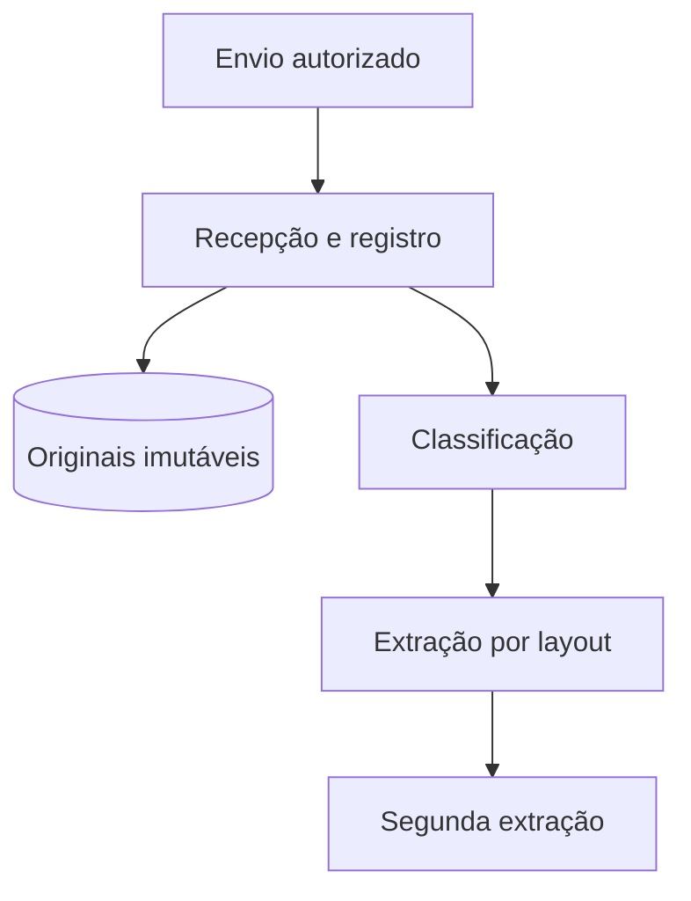

# Vitrine de formatação — Blocos ricos do mdpdf

**Produto:** mdpdf
**Documento:** Documento de demonstração
**Versão:** 1.0
**Data:** 2026-11-03
**Autor(es):** Equipe mdpdf
**Classificação:** Uso interno

---

## Sumário

1. [Abertura de seção](#1-abertura-de-seção)
2. [Avisos](#2-avisos)
3. [Cards, comparação e números](#3-cards-comparação-e-números)
4. [Tabelas técnicas, tags e código](#4-tabelas-técnicas-tags-e-código)
5. [Diagrama clicável](#5-diagrama-clicável)

---

## 1. Abertura de seção

Todo `##` numerado ganha o número como um rótulo curto em fonte mono,
antes do título, e um fio grosso acima. O cabeçalho corrido e os marcadores do
PDF continuam mostrando o título completo, com o número.

Seções sem número, como o Sumário, mantêm só o fio.

## 2. Avisos

Os avisos usam a sintaxe de alertas do GitHub, então o mesmo arquivo continua
legível no GitHub. O rótulo vem no idioma do documento.

> [!NOTE]
> Nota simples: informação de apoio que o leitor pode pular.

> [!TIP]
> Uma dica sobre como usar melhor o resultado.

> [!IMPORTANT]
> Algo que o leitor precisa saber para decidir.

> [!WARNING] Se der errado
> Divergência bloqueia as regras que dependem da célula até a revisão.

> [!CAUTION] Não faça
> Não edite o PDF à mão: o Markdown é a única fonte.

Uma citação comum (sem `[!TIPO]`) continua sendo uma citação:

> O oposto seria enviar 890 páginas a um modelo e pedir “audite o BM017”.

## 3. Cards, comparação e números

Um bloco `::: cards` divide o conteúdo a cada `###`. Com dois ou quatro cards
a grade tem duas colunas; com três, três.

::: cards
##### 1 · catálogo
### O que verificar
Arquivo versionado no Git com uma entrada por regra: ID, versão, cláusula-fonte,
entradas e tolerância.

##### 2 · funções
### Como verificar
Cada regra é uma função pequena em Python com `Decimal`, coberta por testes.

##### 3 · executor
### Quando e sobre o quê
Carrega a base vigente, cruza linhas × regras aplicáveis e grava tudo com a
versão de cada regra.
:::

Um bloco `::: stats` transforma uma lista de `**valor** rótulo` numa faixa de
números:

::: stats
- **3** pontos fixos
- **2** pontos opcionais
- **0** números do LLM em cálculo
- **0** gravações diretas na base
:::

E `::: compare` põe dois painéis lado a lado:

::: compare
### Entra, sempre com trava
1. **Cláusula → evento proposto.** Citação conferida na página.
2. **Atributos sem padrão.** Escolhe entre valores permitidos.
3. **Texto explicativo.** Números vêm do banco; texto com número novo é descartado.

### Não entra
- Registro, hash, manifesto e fila
- Leitura dos números das tabelas
- Conversão para `Decimal` e qualquer soma
- Aprovação da base e dos achados
:::

## 4. Tabelas técnicas, tags e código

Colunas só com números são alinhadas à direita, e tabelas largas quebram dentro
da margem, sem cortar. Código no cabeçalho segue a cor do cabeçalho.

| Regra | Confere | Cálculo do motor | `BM017` informa |
|---|---|---|---|
| QTD-01a | anterior + atual = acumulada | `13.530,95 + 6,35 = 13.537,30` | 13.537,30 |
| QTD-01b | contratada − acumulada = saldo | `18.311,40 − 13.537,30 = 4.774,10` | 4.774,10 |
| ITM-02 | preço = preço vigente | `CTT p. 4 e ADT02 p. 2: 403,14` | 403,14 |
| VLR-01 | valor do período | `6,35 × 403,14 = 2.559,939 → 2.559,94` | R$ 2.559,94 |
| PCT-01 | percentual executado | `13.537,30 ÷ 18.311,40 = 73,93%` | 73,93% |

Um parágrafo feito só de código vira uma fileira de tags:

`Docling` `Camelot` `pdfplumber` `PostgreSQL`

Um parágrafo em itálico logo depois de um bloco de código vira a legenda dele:

```python
@regra("VLR-01", versao=1, estado_sem_dado="erro_extracao")
def valor_do_periodo(linha, base):
    preco = base.preco_vigente(linha.servico, linha.competencia)
    esperado = arredonda(linha.qtd_atual * preco)    # Decimal, 2 casas
    if linha.valor_atual is None:
        return Resultado.erro_extracao("valor do período não lido")
    return Resultado.compara(esperado, linha.valor_atual)
```

*Trecho ilustrativo para mostrar o formato. Não é código do projeto.*

## 5. Diagrama clicável

Clique numa caixa do diagrama para ir à etapa correspondente. Cada etapa tem um
link de volta ao diagrama:



::: steps
##### Pessoas | Sem LLM
### Envio autorizado
Uma pessoa autorizada envia contrato, aditivos, acordo, BMs e anexos.

- **Entra:** Arquivos PDF/XLSX e o contrato a que pertencem
- **Sai:** Arquivos enviados à API

`React` `PDF.js` `SSO (OIDC)`

> [!NOTE] No ADS-24-0090
> Os 6 PDFs da pasta de teste: 890 páginas, 809 delas do contrato.

##### Código determinístico | Sem LLM
### Recepção e registro
Recebe cada arquivo, calcula o SHA-256 e grava o original antes de qualquer leitura.

- **Entra:** Arquivos enviados
- **Sai:** Registro com hash e caminho do original

`FastAPI` `SHA-256`

##### Dados | Sem LLM
### Originais imutáveis
Armazenamento com bloqueio de escrita: o original nunca é sobrescrito.

- **Entra:** Arquivo e hash
- **Sai:** Objeto com lock

`S3/MinIO`

##### Código determinístico | Sem LLM
### Classificação
Decide o tipo de cada documento por regras sobre o texto da primeira página.

- **Entra:** Páginas com texto
- **Sai:** Tipo do documento e páginas sem texto

> [!WARNING] Se der errado
> Arquivo de outro contrato é barrado na classificação e volta com o motivo.

##### Código determinístico | Sem LLM
### Extração por layout
Lê as tabelas monetárias por coordenadas, com um template por layout.

- **Entra:** Páginas de tabela
- **Sai:** Linhas e células com página de origem

`pdfplumber` `templates`

##### IA sem LLM | Sem LLM
### Segunda extração
Extrai de novo as tabelas monetárias por outro método e compara célula a célula.

- **Entra:** Mesmas páginas de tabela
- **Sai:** Lista de células divergentes

`Docling` `Camelot`

> [!IMPORTANT] E o LLM?
> Usa modelos de visão para layout de tabela, não um LLM.
:::
